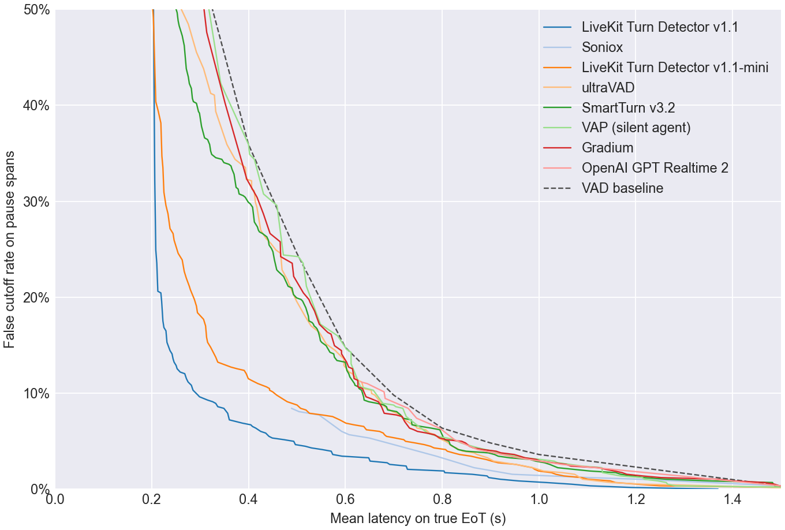
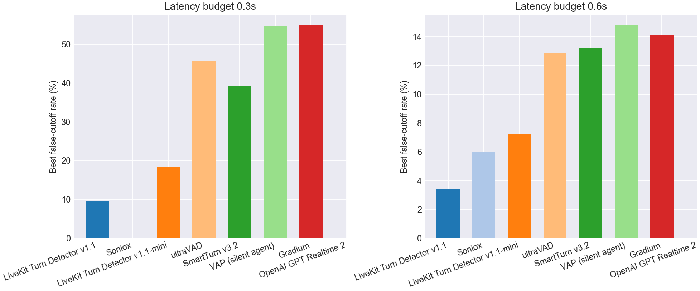
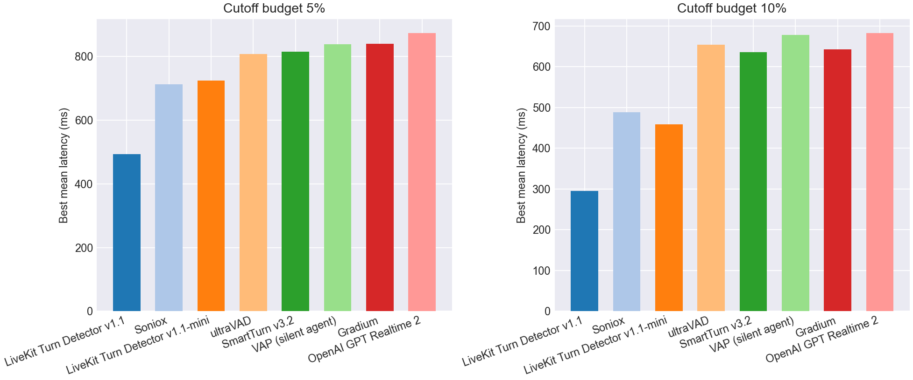

# EoT Model Comparison

## Pareto Frontier

## Best Cutoff Rate at Latency Budget

| Model | Best cutoff rate @ 0.3s latency | Best cutoff rate @ 0.6s latency |
| --- | --- | --- |
| LiveKit Turn Detector v1.1 | **9.6%** | **3.4%** |
| Soniox | - | 6.0% |
| LiveKit Turn Detector v1.1-mini | 18.4% | 7.2% |
| ultraVAD | 45.5% | 12.9% |
| SmartTurn v3.2 | 39.2% | 13.2% |
| VAP (silent agent) | 54.6% | 14.8% |
| Gradium | 54.8% | 14.1% |
| OpenAI GPT Realtime 2 | - | - |
| VAD baseline | 54.8% | 14.8% |

## Best Latency at Cutoff Budget

| Model | Best mean latency @ 5% cutoff | Best mean latency @ 10% cutoff |
| --- | --- | --- |
| LiveKit Turn Detector v1.1 | **493 ms** | **296 ms** |
| Soniox | 713 ms | 489 ms |
| LiveKit Turn Detector v1.1-mini | 724 ms | 458 ms |
| ultraVAD | 807 ms | 654 ms |
| SmartTurn v3.2 | 814 ms | 636 ms |
| VAP (silent agent) | 839 ms | 678 ms |
| Gradium | 840 ms | 643 ms |
| OpenAI GPT Realtime 2 | 873 ms | 682 ms |
| VAD baseline | 900 ms | 700 ms |

## Operating Points

| Type | Budget | Model | Mean Latency | Cutoff | Detect | Threshold | Action Delay | Timeout |
| --- | --- | --- | --- | --- | --- | --- | --- | --- |
| Cutoff | 5.0% | LiveKit Turn Detector v1.1 | 0.493 | 5.0% | 77.4% | 0.670 | 0.200 | 1.500 |
| Cutoff | 5.0% | Soniox | 0.713 | 4.5% | 79.3% | 0.990 | 0.500 | 1.500 |
| Cutoff | 5.0% | LiveKit Turn Detector v1.1-mini | 0.724 | 5.0% | 39.4% | 0.700 | 0.300 | 1.000 |
| Cutoff | 5.0% | ultraVAD | 0.807 | 5.0% | 86.6% | 0.070 | 0.700 | 1.500 |
| Cutoff | 5.0% | SmartTurn v3.2 | 0.814 | 5.0% | 92.9% | 0.090 | 0.800 | 1.000 |
| Cutoff | 5.0% | VAP (silent agent) | 0.839 | 4.8% | 50.4% | 0.130 | 0.600 | 1.000 |
| Cutoff | 5.0% | Gradium | 0.840 | 5.0% | 63.8% | 0.280 | 0.700 | 1.000 |
| Cutoff | 5.0% | OpenAI GPT Realtime 2 | 0.873 | 4.1% | 90.8% | 0.990 | 0.800 | 1.500 |
| Cutoff | 10.0% | LiveKit Turn Detector v1.1 | 0.296 | 9.8% | 92.7% | 0.360 | 0.200 | 1.500 |
| Cutoff | 10.0% | Soniox | 0.489 | 8.4% | 79.3% | 0.990 | 0.200 | 1.000 |
| Cutoff | 10.0% | LiveKit Turn Detector v1.1-mini | 0.458 | 9.8% | 67.7% | 0.520 | 0.200 | 1.000 |
| Cutoff | 10.0% | ultraVAD | 0.654 | 10.0% | 94.0% | 0.040 | 0.600 | 1.500 |
| Cutoff | 10.0% | SmartTurn v3.2 | 0.636 | 10.0% | 91.1% | 0.150 | 0.600 | 1.000 |
| Cutoff | 10.0% | VAP (silent agent) | 0.678 | 8.9% | 88.7% | 0.050 | 0.600 | 1.000 |
| Cutoff | 10.0% | Gradium | 0.643 | 9.6% | 89.8% | 0.140 | 0.500 | 1.000 |
| Cutoff | 10.0% | OpenAI GPT Realtime 2 | 0.682 | 9.5% | 90.0% | 0.990 | 0.600 | 1.000 |
| Latency | 300ms | LiveKit Turn Detector v1.1 | 0.299 | 9.6% | 87.7% | 0.530 | 0.200 | 1.000 |
| Latency | 300ms | Soniox | - | - | - | - | - | - |
| Latency | 300ms | LiveKit Turn Detector v1.1-mini | 0.294 | 18.4% | 88.2% | 0.300 | 0.200 | 1.000 |
| Latency | 300ms | ultraVAD | 0.292 | 45.5% | 88.5% | 0.060 | 0.200 | 1.000 |
| Latency | 300ms | SmartTurn v3.2 | 0.299 | 39.2% | 87.7% | 0.260 | 0.200 | 1.000 |
| Latency | 300ms | VAP (silent agent) | 0.272 | 54.6% | 98.7% | 0.020 | 0.200 | 1.000 |
| Latency | 300ms | Gradium | 0.300 | 54.8% | 100.0% | 0.000 | 0.300 | 1.000 |
| Latency | 300ms | OpenAI GPT Realtime 2 | - | - | - | - | - | - |
| Latency | 600ms | LiveKit Turn Detector v1.1 | 0.593 | 3.4% | 75.6% | 0.700 | 0.300 | 1.500 |
| Latency | 600ms | Soniox | 0.592 | 6.0% | 79.3% | 0.990 | 0.200 | 1.500 |
| Latency | 600ms | LiveKit Turn Detector v1.1-mini | 0.588 | 7.2% | 58.8% | 0.590 | 0.300 | 1.000 |
| Latency | 600ms | ultraVAD | 0.597 | 12.9% | 80.6% | 0.100 | 0.500 | 1.000 |
| Latency | 600ms | SmartTurn v3.2 | 0.600 | 13.2% | 80.1% | 0.510 | 0.500 | 1.000 |
| Latency | 600ms | VAP (silent agent) | 0.600 | 14.8% | 100.0% | 0.000 | 0.600 | 1.000 |
| Latency | 600ms | Gradium | 0.592 | 14.1% | 92.7% | 0.090 | 0.500 | 1.000 |
| Latency | 600ms | OpenAI GPT Realtime 2 | - | - | - | - | - | - |
